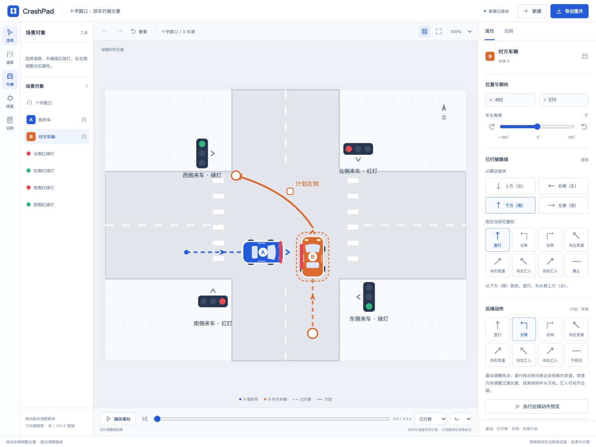
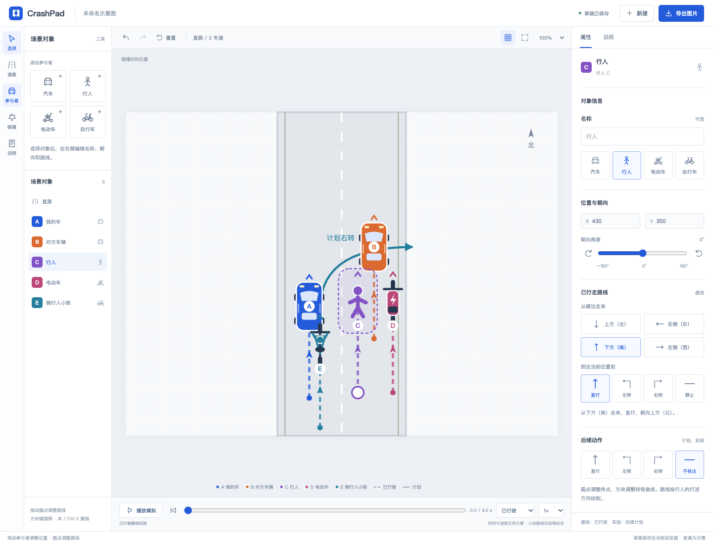
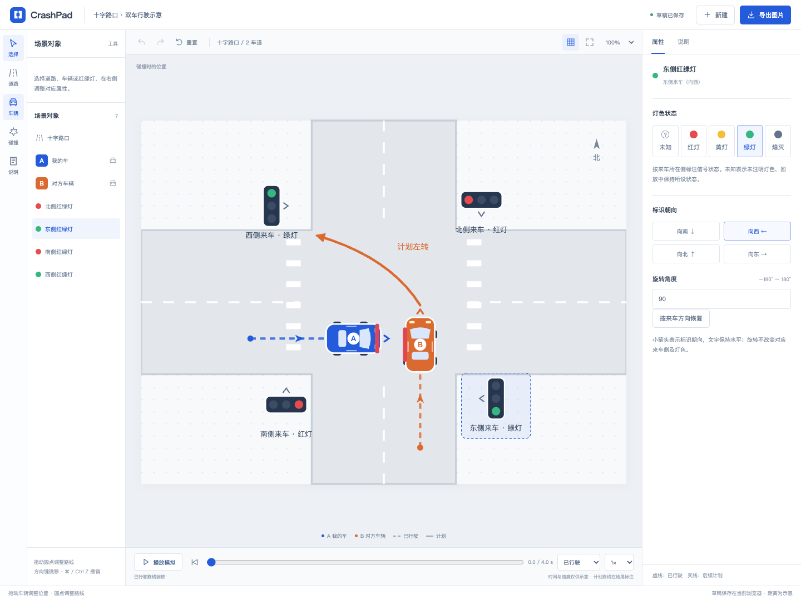
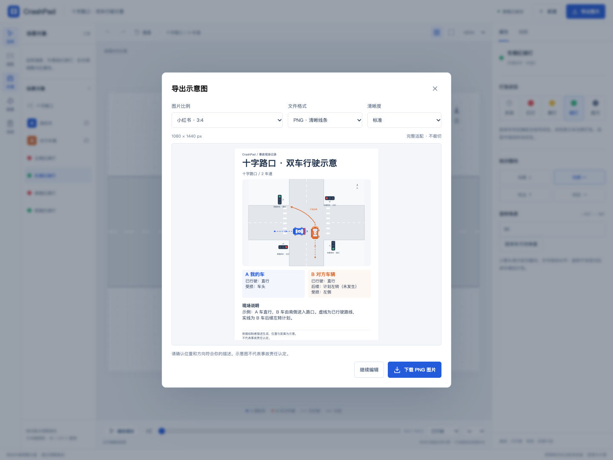
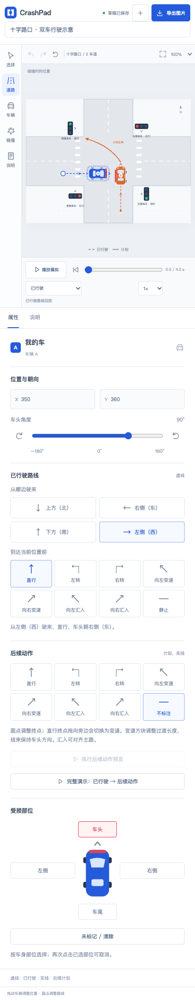

<p align="center">
  
</p>

<h1 align="center">CrashPad</h1>

<p align="center">用拖拽代替手绘，快速讲清车辆碰撞现场。</p>

<p align="center">
  
  
  
</p>

<p align="center">
  <a href="#界面预览">界面预览</a> ·
  <a href="#主要功能">主要功能</a> ·
  <a href="#快速开始">快速开始</a> ·
  <a href="#使用文档">使用文档</a> ·
  <a href="https://github.com/DangJin/CrashPad/issues">反馈问题</a>
</p>

CrashPad 是一个在浏览器中运行的事故示意图工作台。选择道路、摆放车辆、调整路线，即可表达直行、转弯、变道及匝道汇入等过程，并导出图片或 GIF。左侧选择模板和对象，右侧统一设置属性；场景和动图均在本地处理。

## 界面预览

### 画布与对象属性



点击车辆、道路或红绿灯，右侧自动切换为对应属性。虚线表示已行驶路线，实线表示尚未发生的计划。

### 多类型参与者



从左侧“参与者”添加对象；支持修改名称与类型、拖动定位、设置路线、删除及撤销恢复。

### 红绿灯与导出预览

| 红绿灯独立设置 | 小红书竖版导出 |
| --- | --- |
|  |  |

<details>
<summary>查看移动端界面</summary>

<p align="center">
  
</p>

</details>

截图均使用虚构演示场景，不包含真实事故或个人信息。

## 主要功能

| 功能 | 内容 |
| --- | --- |
| 道路模板 | 直路、十字路口、丁字路口、停车区域、匝道汇入 / 汇出、车道增加 / 减少 |
| 路线编辑 | 汽车、行人、电动车和自行车的位置、来向、−180°～180° 朝向，直行、转弯、变道、汇入及可拖动的路线控制点 |
| 现场标注 | 碰撞点、车身受损部位点选、各方向红绿灯、事故说明、地点和时间 |
| 过程演示 | 已行驶、后续动作、完整演示；暂停、拖动进度及变速，结束后自动返回编辑 |
| 图片与 GIF | PNG / JPG / 循环 GIF；原图、3:4、9:16、1:1、4:3、16:9 比例与高清选项 |
| 编辑体验 | 标题编辑、本地自动保存、撤销 / 重做、重置、网格、缩放和移动端适配 |

小红书和抖音预设使用独立竖版排版。导出时自动隐藏未设置的后续动作、空白说明和未知灯色；GIF 支持生成进度与取消。

## 快速开始

需要 **Node.js 20.19+ 或 22.12+** 和 **npm**。

```sh
git clone https://github.com/DangJin/CrashPad.git
cd CrashPad
npm ci
npm run dev
```

打开 <http://127.0.0.1:5173>，在终端按 `Ctrl+C` 停止服务。项目固定使用 `5173` 端口；已有本项目服务时可直接复用。

### 绘制一张示意图

1. 从左侧选择道路模板，在右侧设置车道和方向。
2. 从左侧“参与者”添加汽车、行人、电动车或自行车，拖动定位，在右侧设置名称、类型、来向和已行驶动作，按需添加后续计划。
3. 标注碰撞点、受损部位与红绿灯，填写现场说明。
4. 播放“完整演示”检查过程，再选择比例和格式导出。

### 导出规格

| 预设 | PNG / JPG 标准尺寸 |
| --- | --- |
| 原图 | 宽 1760 px，高度随内容调整 |
| 小红书 · 3:4 | 1080 × 1440 px |
| 抖音竖屏 · 9:16 | 1080 × 1920 px |
| 方形 / 横图 / 宽屏 | 1080 × 1080 / 1440 × 1080 / 1920 × 1080 px |

PNG / JPG 支持两倍尺寸；GIF 标准长边最多 960 px，高清最多 1440 px，保持所选比例。

## 使用文档

- [使用指南](./docs/usage.md)：路线含义、朝向、三种演示模式、导出和快捷键。
- [开发与验证](./docs/development.md)：测试、构建、代码结构及截图更新方法。

### 常用开发命令

```sh
npm run check       # 核心 JavaScript 语法检查
npm test            # 模型与导出逻辑测试
npm run build       # 生成 dist/ 静态产物
```

浏览器测试首次运行需要安装 Chromium：

```sh
npx playwright install chromium
npm run test:browser
```

已有开发服务时使用 `CRASH_PAD_REUSE_SERVER=1 npm run test:browser`。构建预览与开发服务均使用 `5173` 端口，请勿同时启动；更多说明见[开发文档](./docs/development.md)。

## 数据与使用边界

- 支持添加、删除多个参与者，只在当前浏览器保存一个草稿。清除浏览器数据会丢失草稿，不提供跨设备同步。
- 图片和 GIF 在浏览器本地生成，无需上传场景到服务器。
- 完整演示的后半段为计划，不代表已经发生；动画不还原真实车速或碰撞物理过程。
- 所有图示均依据绘制者描述生成，位置与距离为示意，**不代表事故责任认定**。

## 反馈与贡献

欢迎通过 [GitHub Issues](https://github.com/DangJin/CrashPad/issues) 提交问题或建议。报告问题时请说明操作步骤、预期结果、浏览器与设备，并尽量使用不含个人信息的示例。

提交 Pull Request 前，请运行与改动相关的测试；界面变更请附上截图。维护者：[DangJin](https://github.com/DangJin)。
