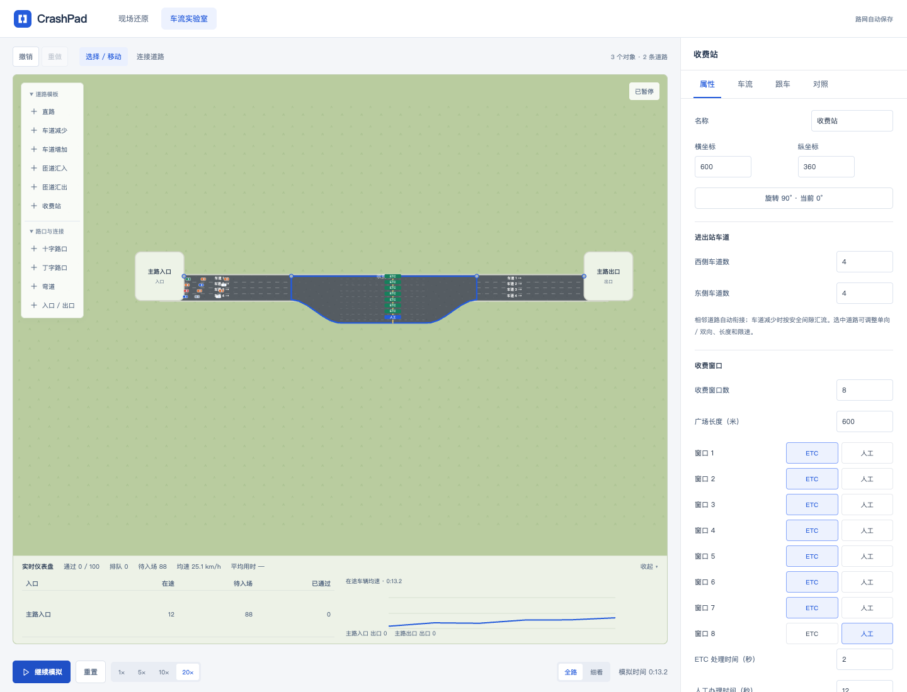

# 统一车流实验室

[返回项目首页](../README.md) · [旧线性实验说明](traffic.md)

打开 `/#/traffic`。线性道路与自由路网已合并为同一画布，原 `/#/traffic/network` 地址继续可用。整个编辑和模拟过程运行在浏览器中，无需 Python、SUMO 或模拟服务端；可继续部署到静态托管平台。

## 开始体验

默认是双向各两车道的四向路口，共 100 辆车，入口目的地按直行 60%、左转 30%、右转 10% 分配。点击开始，车辆按路线提前选道、停车让行和通过。点击车辆可查看目的地、路线及等待原因。

## 搭建路网

- 左侧道路模板可将直路、车道增减、匝道或收费站一键插入当前道路。选中道路时插入该道路；未选择时使用相邻或最后一条道路，自动腾出布局空间。新增匝道入口默认车辆数为 0，需在右侧设置。
- 左侧添加十字路口、丁字路口、90°弯道或入口 / 出口。对象可拖动，或在右侧输入坐标；每次旋转 90°。
- 直接点击两个空闲端口，或从一个端口拖线到另一个端口，即可连接；兼容目标会高亮，Esc 或点击空白处取消。已连接端口点击后选择对应道路。两端需水平或垂直对齐，中心间距按组件尺寸保留安全空间（至少 120）；拖动时相近坐标会吸附。未连接对象移动到距离 120～200 的兼容空端口附近时，可自动建立一条连接。
- 选择道路，设置每方向 1～6 条车道、长度和限速。右侧通行，车道 1 最靠近中心线。模拟使用物理长度，画布距离只决定外形。
- 路口 / 弯道所有端口都需连接；红色端口表示缺少连接。断路、重叠、无路口的平面交叉或不可达目的地会阻止启动。
- Backspace / Delete 删除选中对象或道路，输入文字时不触发；删除对象也删除关联道路。支持最多 60 步撤销 / 重做，快捷键为 Cmd/Ctrl+Z、Cmd/Ctrl+Shift+Z 或 Ctrl+Y；编辑历史只保留在当前页面。
- 道路可切换单向或双向；本版双向道路同宽，路口连接通过转向轨迹适配不同车道数。弯道两端所有车道连续连接。

## 车流与路线

在右侧「车流」选择入口，设置车辆数、每分钟入场流量和目的地比例。所有入口车辆总数为 1～300，单入口流量 1～240 辆/分钟。调整目的地的一项比例，其他项按比例分配，合计 100%。入口支持均匀、偏左、偏右分布，仍遵守路线所需车道。三类驾驶风格为全路网共享配比。

车辆使用固定种子分配属性和目的地，按最短可行道路距离选择路线。路口转向限制参与寻路；因变道不及时错过转向时，仅从当前车道的合法连接寻找绕行。无法绕行且在停止线等待 30 秒后，明确计为「路线未完成」，不计入已抵达或平均完成时间。

选择「跟车」可设置自己的入口、车道、目的地、驾驶风格与主动变道开关。我的车替换所选入口中间的一辆车，入场等待计入总用时。关闭主动变道仍会为路线进行必要选道；抵达后计时冻结，同一场景的体验记录在本次页面保留。

## 信号、让行与掉头

- 选中路口，在属性中逐车道开启允许的直行、左转、右转或掉头。默认内侧车道可直行 / 左转，外侧车道可直行 / 右转；掉头默认关闭。
- 想做掉头实验，先在驶入车道开启掉头，再将该入口本身设为目的地；也可在我的路线中选择返回入口。
- 信号提供东西 / 南北轮流通行，以及直行 / 左转分别放行。绿灯时长可调，黄灯 3 秒、全红至少 2 秒，车尾未清空时延迟放行。
- 无信号时可指定东西或南北主路。次路让主路，左转让冲突的直行和右转，掉头让其他冲突车辆；同优先级按队首到达顺序仲裁。
- 出口空间不足时禁止进入路口。相交轨迹由冲突占用控制，不允许冲突车辆同时进入；当前策略偏保守，通行能力未经现实数据标定。黄灯统一停车，不模拟抢黄灯和红灯右转。

## 收窄、匝道与收费站

- 「快速开始」提供直路、3→1 收窄、匝道汇入 / 汇出、4→8→4 收费站、十字与丁字路口；也可将这些模板插入同一场景。
- 选中车道变化路段，可直接调整两侧车道数与路段长度。汇流车辆共享出口车道的跟车间距，按安全间隙连续通行，不把整段收窄区当成一次只能通过一辆车的冲突区。
- 选中汇入路段，可设置支路车辆数和流量；各入口数量相加为实验总数。选中汇出路段，可为每个入口设置驶向该支路出口的比例。
- 收费站支持最多 12 个窗口、进出口各 1～6 车道，窗口数不小于进出口车道数。双向道路两方向有独立窗口组，单向 4→8→4 示例只有一组 8 个窗口。
- 每个窗口可选择 ETC / 人工，分别设置 ETC 放行间隔和人工办理时间。车流设置支持 ETC 车辆占比：非 ETC 车辆仅走人工，ETC 车辆可选两者。车辆提前选窗与准备车道；ETC 无拥堵时低速通过，人工停车办理。默认资格比例 100% 用于兼容旧场景，并非现实统计。内部队列与出站汇流参与全路网寻路、统计和 A/B。
- 路段可独立设置红绿灯周期；路口继续使用分方向信号与让行设置。

## 对照、保存与运行边界

- 实时模拟和 A/B 都使用 Web Worker 与 0.1 秒固定步长；倍速只改变推进速度，不改变计算结果。暂停页面或切换模块会暂停 / 终止对应计算。
- A/B 各运行三个配对种子，显示通过量、截止时间、均速、完成平均用时与我的抵达用时，并附计算时的路线快照。路线距离不同的结果代表整个场景差异。
- 统一草稿和 A/B 存于 `crashpad:network:v1`，事故草稿保持独立。未连接完的编辑草稿也可保存恢复。旧 `crashpad:traffic:v1` 原数据不删除、不覆盖；没有路网草稿时自动尝试转换旧草稿与 A/B，已有路网时可在属性页底部逐份导入旧草稿或旧方案，并可撤销导入。
- 转换保留车辆总数、流量、驾驶风格、收费窗口与我的车设置；旧线性道路会生成实际路网连接，分支目的地使用百分比分配，布局、路线距离与模拟时间重新计算，不保证与旧引擎数值一致。转换失败会保留旧数据，可按提示修正后重试。
- 最多 40 个对象、60 条道路、300 辆车；每次模拟上限 30 分钟。截止时未完成的车辆不会被当作成功抵达。
- 所有道路设施在统一引擎内运行。不含行人 / 自行车混行、碰撞物理、地图导入与真实交通参数标定。

### 画布操作与比例调整

- 默认从连续直路开始。点击出口的「＋」续接道路；选中道路后可点击「插入路段」。续接保留上游位置和当前比例，仅在新路段超出视野时平移。已有草稿继续保留。
- 单一直线走廊纵向缩放时，横向车道保持至少 48 px；分支与路口使用等比视图。车辆、信号和文字保持屏幕尺寸。右下角可加减或输入比例（1%～600%），「定位」聚焦对象，「全景」查看道路范围。Ctrl / ⌘ + 滚轮、双指手势可缩放；普通滚轮平移，横向走廊自动沿道路滚动。
- 拖动空白处平移；也可按住空格 / 鼠标中键拖动。手动浏览会退出跟车，缩放和平移不修改路网、不重置模拟。
- 目的地、驾驶风格及驶出比例均支持滑动条和数字输入；两种操作同步，关联比例自动保持总计 100%。
- 道路在组件端口处收口，不延伸到组件中心；拖动组件或修改坐标时，关联的横向道路行、纵向道路列保持对齐，靠近邻居时自动限位。布局变化可撤销，不改变道路的模拟长度。旧草稿里的斜线或过近连接显示为虚线提示，可拖动对应组件重新对齐。
- 编辑不区分模式：拖动组件移动、拖动空白处平移、点击或拖动端口接线。「清空画布」一次移除当前组件、连接和车流需求，可一次撤销恢复；已保存的 A/B 方案保留。入口出口使用连续路面端点，连接点按实际路面中线显示；已连接端口在选中或悬停时显示。拖动预览标明关联对象数量，Esc 可取消。

### 匝道几何

汇入、汇出使用斜向支路及连续曲线，与模拟车辆共用路径几何；汇接处不再使用方形路口。旧垂直匝道在读取或载入方案时转换，保留车流需求、目的地和物理路长。分流汇流仍保留冲突检查，匝道车辆让行主路。
