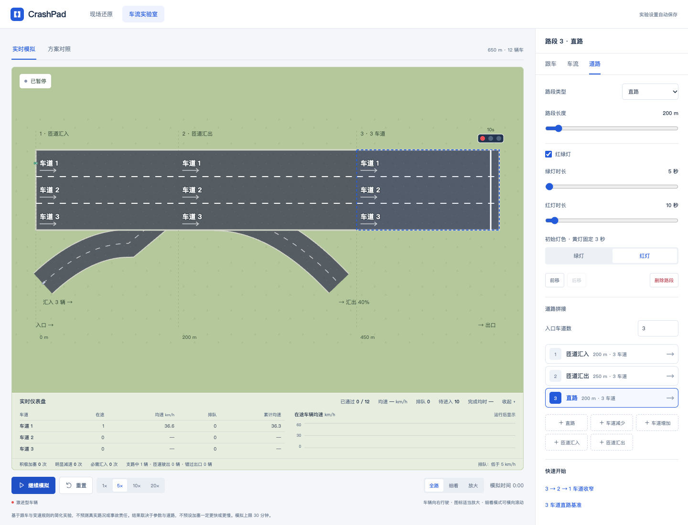
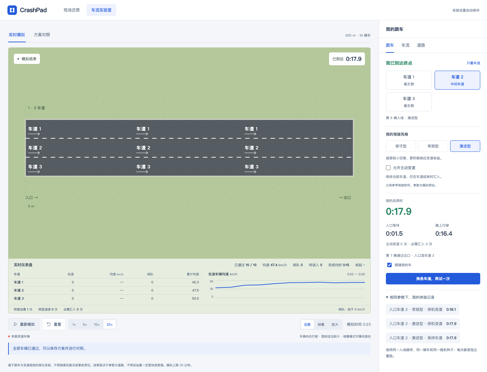
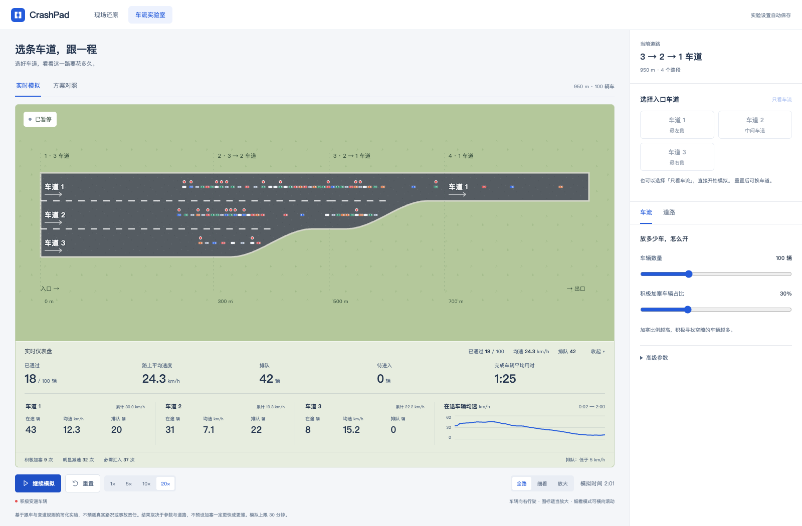
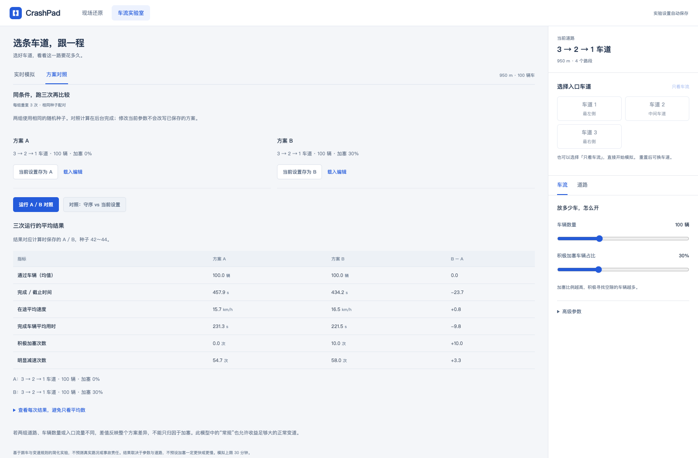

# 旧线性实验说明

[返回项目首页](../README.md)

> 当前车流实验室已合并为[统一画布](network.md)。本文保留旧版本参数与模型口径，便于理解历史实验；旧兼容入口为 `/#/traffic/legacy`，原始草稿和方案不会被删除。

车流实验室用于探索道路收窄、车辆数量和变道行为对通行的影响。它和「现场还原」是两个独立模块：前者生成实验，后者描述用户画出的经过。

## 开始一个实验

1. 从顶部进入 **车流实验室**，或打开 `/#/traffic`。
2. 在设置栏切换到「道路」，按行驶顺序拼接路段：直路、车道减少、车道增加、匝道汇入、匝道汇出。入口支持 1～6 车道，最多 10 段，每段 100～1500 米。
3. 点击画布路段，右侧直接切换到该段属性，可调整长度、增减车道数量和左右侧；使用前移、后移、删除改变拼接顺序。前一段出口自动作为后一段入口，非法的车道连接会提示并阻止运行。
4. 在「车流」设置车辆总数和保守型、常规型、激进型三类司机比例；入口流量、期望速度、分布和种子位于「高级参数」。手机端可用「调整设置 / 收起设置」控制属性区。
5. 点击开始模拟，可暂停、重置和使用 1 / 5 / 10 / 20 倍速。全路模式看整体，细看和放大模式可横向滚动观察车辆；点击车辆查看速度与驾驶倾向。
6. 试验场底部的半透明「实时仪表盘」数据带以紧凑列表逐行显示各车道的在途数量、当前均速、低速排队及累计均速，并显示带速度刻度、采样时间范围的实时均速趋势图，点击标题可一起收起；桌面将车道列表与曲线并排，整体指标集中在标题栏，减少仪表盘高度；手机将曲线排列在列表下方。整体概况也集中在仪表盘：已通过、路上平均速度、排队、待进入、完成车辆平均用时分别展示；收起后保留通过数、均速和排队摘要。累计车道均速、驾驶行为计数和指标说明也放在主区域，右侧仅保留设置与个人跟车结果。修改设置会重置当前运行。

首个预设为 **3 → 2 → 1 车道**，入口 100 辆、120 辆/分钟、期望速度 60 km/h。三类比例合计 100%，调整一项时其余两项按比例分配剩余额度；界面显示取整后的实际人数。参与体验时，配比只应用于除我之外的司机。按随机种子稳定分配风格，人数使用最大余数法取整，总车辆数不变。默认从旧版 30% 加塞配置兼容为保守 0%、常规 70%、激进 30%，这不是现实司机人群的统计比例。车辆按节奏进入；入口没有空间时在路外排队，不会把所有车辆重叠放在道路上。

拼接采用连续单向主路与可见匝道支路，不包含十字路口或任意路网连接。每段可单独启用红绿灯。

中间为试验场，底部集中开始/暂停、重置、倍速和缩放控制；右侧采用与现场还原一致的选择属性模式：跟车、车流、道路、所选车辆分别显示，互不堆叠；点击路面直接打开该段属性并高亮，切换对象时回到属性顶部。道路拼接列表排列在所选路段设置下方。展开设置不会挤压桌面画布。手机上设置区排列在试验场下方。高级参数和详细统计按需展开，A/B 对照集中在「方案对照」页面。

## 匝道与红绿灯

- 在右侧「道路拼接」添加「匝道汇入 / 匝道汇出」，或选中已有路段切换类型。画布会绘制可见的左侧或右侧支路，点击支路直接编辑该段。汇入支路与汇入渐变段使用同一条平滑曲线，接入口不再保留横穿路面的主路边线；标注放在支路外侧，选择反馈沿路缘显示。
- **汇入**：设置汇入车辆数和匝道入口流量。车辆总数包含匝道车辆，主路入口数量相应减少，并至少保留 1 辆。车辆在支路内按间距排队，待目标车道前后空隙满足约束后汇入。多条入口支路的车辆数相加，不可达到或超过总车辆数。
- **汇出**：设置驶出车辆比例，按种子从有机会经过该出口的其他车辆中选定目标车辆。它们提前向出口车道靠拢，驶入支路后继续行驶至匝道出口；没赶上出口就继续主路，不强行跳转。多个出口依次从尚未分配出口的车辆中选取，因此是各段可用车辆的比例，而非全体车辆的重复百分比。
- 我的车始终从主路入口进入并走到主路终点，不自动分配匝道出口，便于比较车道与驾驶风格。司机风格配比覆盖主路和匝道的其他车辆。
- **红绿灯**：选中路段，启用「红绿灯」，设置红灯和绿灯时长（5～120 秒）以及初始灯色，黄灯固定 3 秒。停止线位于段末前 12 米，控制该方向的全部主路车道。红灯和黄灯时车辆在停止线前等待，绿灯时放行；已通过停止线的车不会倒退。当前规则将黄灯统一视作停车阶段，不模拟黄灯决策差异。
- 仪表盘的完成数量包含主路终点与匝道出口；匝道中车辆、匝道完成量和错过出口数量另外显示。车道列表只统计主路车辆，趋势图与全局均速包含支路车辆。不同出口的行程长度不同，整体平均完成时间不可直接当作同一路程的速度收益。
- 支路车道、汇入动画、驾驶策略和信号周期均为简化机制，没有交通需求标定或完整冲突区模型。

## 我来跟一程

在右侧「跟车」选择入口车道和「我的驾驶风格」，然后开始模拟。你会作为这批车中间的一辆车入场（第 `floor(主路入口车辆数 / 2) + 1` 辆），包含在车辆总数内，不额外插入车辆。不同车道体验使用相同车辆属性和计划入场时间。

- 我的车带有「我」标识。「保守型、常规型、激进型」决定跟车与变道参数；「允许主动变道」是独立策略开关。关闭时只在车道结束时汇入，仍保留所选风格的跟车距离；开启时按该风格择机变道。默认是常规型、关闭主动变道。所有组合保留间距检查和防穿透约束。
- 等待轮到入场时显示倒计时，计时从计划入场时刻开始。入口堵塞等待也计入总用时，另行显示路上行驶时间。
- 暂停模拟时个人计时也暂停；抵达终点后个人用时冻结，显示通过顺序。
- 「跟随我的车」在细看和放大模式中自动平移画布，不滚动整个页面。
- 「换条车道，再试一次」重置整场模拟，重新选择入口车道。相同道路、车流参数和种子下，各车道、各风格与变道开关组合的最近一次体验用时会留在本次页面中，方便比较；更改其他参数后不混用旧记录。
- A/B 方案会保存入口车道、驾驶风格与主动变道开关，对照结果中额外展示已抵达的个人用时均值。

这不是驾驶操作游戏：本版按所选风格自动跟车和变道，途中不提供手动变道或油门控制。个人记录只保留在当前页面，刷新后可用保存的配置重跑。

风格预设是当前模型内的示意策略，尚未按真实驾驶数据标定。三种风格保持同一辆车、入场时间、期望速度和随机种子，只调整跟车与变道策略，不预设哪种风格一定更快。运行中不可修改，重置后可切换；页面显示主动变道与必要汇入次数。

| 风格 | 跟车时距 | 收益确认时间 | 变道后冷却 | 主动返回原车道间隔 |
| --- | --- | --- | --- | --- |
| 保守型 | 1.8 s | 2.4 s | 10 s | 30 s |
| 常规型 | 1.5 s | 1.5 s | 7 s | 20 s |
| 激进型 | 1.2 s | 0.7 s | 4 s | 12 s |

以上为本项目的模拟预设值，并非研究统计出的分组均值。关闭主动变道后，确认时间、冷却和返回间隔不用于主动变道。冷却从两秒变道动画结束后计算，必要汇入可绕过主动返回限制。收益门槛及间隙参数见 `src/traffic/drivingStyles.js`。

分类参考：[基于 highD 的驾驶风格聚类研究（2023）](https://www.mdpi.com/1424-8220/23/9/4570)、[130 名司机自然驾驶数据的分组研究（2023）](https://doi.org/10.1016/j.trip.2023.100900)、[真实道路跟车风格研究（2022）](https://doi.org/10.1108/JICV-07-2021-0008)。这些研究支持分类与指标方向，不提供本模拟器的参数标定。

旧配置兼容：`hold` → 常规型、关闭主动变道；`steady` → 保守型、开启；`experienced` → 常规型、开启；`hurry` → 激进型、开启。已有显式开关设置优先，缺少风格的早期配置仍保持不主动变道。

## 方案对照

- **全常规 / 当前配比快捷对照**：将当前配置复制成两组，A 的其他司机全部设为常规型，B 保留当前风格配比。我的风格、入口车道和主动变道开关保持一致。
- **自定义 A / B**：分别保存两组道路与车辆参数，然后运行对照。载入编辑只修改当前实验设置。
- 两组采用同一组种子，分别重复三次；每次的期望速度、入场时间等随机属性由种子确定。显示平均结果，也可展开每次运行结果。
- 比较不同道路时，差值代表整个方案差异；不能只归因于加塞。三次运行只是基础敏感性检查，不是统计显著性结论。
- 对照通过 Web Worker 在后台计算，可取消；离开模块会终止后台任务。

## 模型与口径

### 跟车

采用简化 [IDM 跟车模型](https://mtreiber.de/MicroApplet/IDM.html)：车辆根据自身速度、前方净间距和相对速度决定加减速。默认加速度 1.5 m/s²、舒适减速度 2 m/s²、跟车时距 1.5 秒、静止间距 2 米、车长 4.5 米。每辆车的期望速度在设定值的 ±10% 内随机取值。

固定时间步长 0.1 秒，模拟速度仅改变每帧推进多少步，不改变模型方程。车辆不后退；变道期间在原车道与目标车道同时占位，并加上非穿透约束。

### 变道与汇入

变道规则参考 [MOBIL](https://mtreiber.de/MicroApplet/MOBIL.html) 的收益与安全约束思想，**不是该模型的完整实现**：

- 常规车辆也允许收益足够大的普通变道，车道结束时会尝试向可继续行驶的车道汇入。
- 积极车辆接受更小的前后间距、更低的变道收益和更短的变道冷却，但仍检查目标车道前后车辆；不会随机瞬移进一辆车内部。
- 常规车辆会为临近车道结束的车辆留出空间。主路换道动画持续 2 秒；完成后常规车辆至少保持 7 秒、积极车辆至少保持 4 秒再判断下一次变道。匝道汇入使用连续二次曲线，车辆按行进距离沿同一曲线进入主路，走完汇入段后才释放双车道占位；不会用固定两秒侧移截断支路轨迹。
- 主动变道需要收益连续稳定（常规至少 1.5 秒，积极至少 0.7 秒）；常规车辆 20 秒内、积极车辆 12 秒内不主动返回刚离开的车道。即将结束的车道不作为主动超车目标，必需汇入可绕过返回限制。
- 为避免把跟车能力变化误当成加塞效果，两种倾向使用相同跟车时距与基本加减速参数。
- 积极车辆由种子随机选取，数量为 `round(车辆数量 × 占比)`。占比描述驾驶倾向，不保证每辆积极车辆都能找到变道机会。

### 统计

| 指标 | 口径 |
| --- | --- |
| 在途均速 | 当前仍在路上车辆的瞬时均速；累计均速按车辆在途时间加权 |
| 低速排队 | 在路上、速度低于 5 km/h 的车辆数；待进入车辆单独显示 |
| 完成车辆用时 | 从计划进入时刻到实际通过出口，包含入口等待；未通过者不计入均值 |
| 积极加塞次数 | 积极车辆主动选择的非必需变道次数 |
| 必需汇入次数 | 因车道结束而进行的变道次数；多次跨车道分别计数 |
| 明显减速次数 | 实际速度下降对应减速度超过 3 m/s² 的一次连续事件 |
| 各车道统计 | 按当时所在的物理车道累计，不等同于某入口车道的全程收益 |

单次运行最多 30 分钟模拟时间，仍未通过时明确标记截止，不把它当作全部通行耗时。没有完成车辆时，完成用时显示空值。

这是面向车友的简化机制实验，尚未用真实路段数据标定，不预测真实通行速度、事故风险或责任。模型不预设加塞一定让整体更快或更慢。

## 数据与边界

配置及 A/B 快照保存在浏览器 `crashpad:traffic:v1`，与原现场草稿 `crashpad:draft:v1` 分离。模拟的车辆位置、实时结果和对照结果不持久化；刷新或离开模块会结束运行，回来后可使用保存的参数重新开始。清空浏览器数据会删除实验设置。

### 高速收费站

在道路拼接中添加「高速收费站」，入口车道继承上一段，独立设置收费窗口数（最多 12 个）和出口车道数（1～6 条）。窗口数需不少于进出口车道数。收费广场自动扩宽、收窄，下一路段接续出口车道；快速开始提供「4 → 8 个 ETC 窗口 → 4 车道」。每个窗口可设置 ETC / 人工，参数随道路保存，也用于 A/B 对照。

车辆进入广场后，按预计处理队列与横向移动距离选择窗口，安全变道接近目标；临近窗口 25 米及办理中禁止变道。办理后沿出口收窄区域依次汇流。当前广场向右侧扩宽，窗口布置不支持自由拖动。

ETC 默认处理 2 秒、人工默认处理 12 秒，均为可调实验参数。当前简化模型中两类窗口均需减速停留，车辆均可使用任意窗口，不区分 ETC 资格。多座收费站独立计时。
