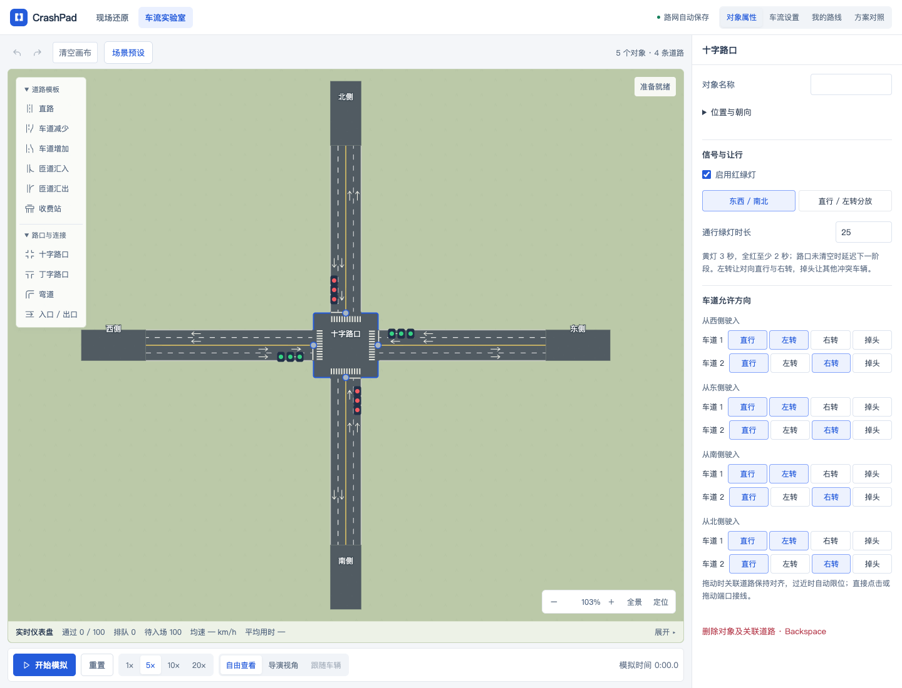
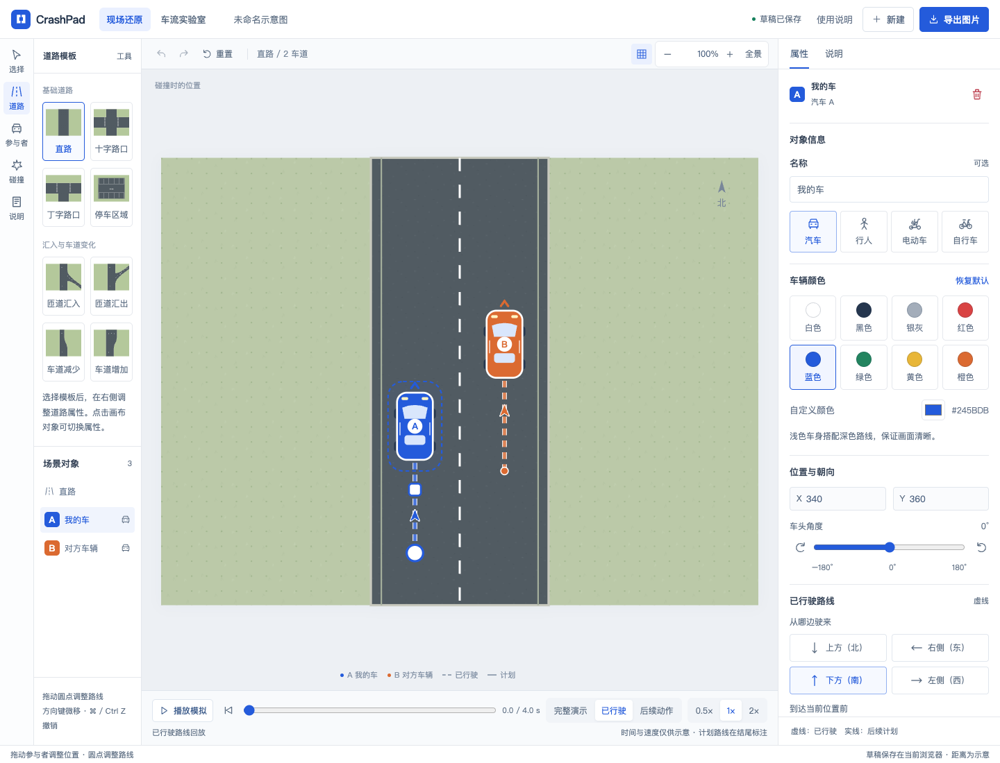
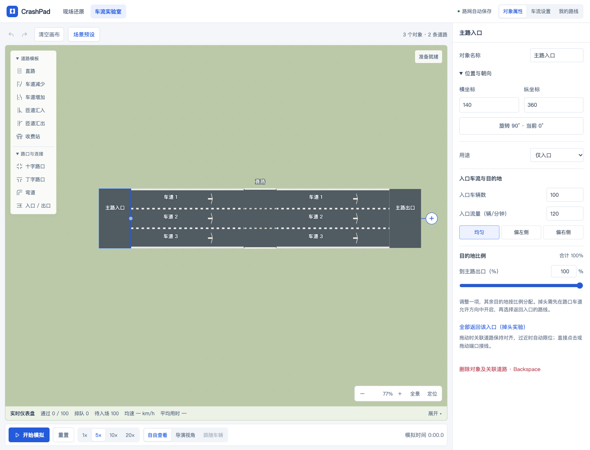

# 工作台升级验证

## 本轮交付

- 现场还原 `/#/` 与实验室 `/#/traffic` 使用统一导航、历史、缩放、播放样式及语义颜色。
- 路网页面拆分对象属性、车流、跟车、方案对照、仪表盘；全局车流入口选择与画布选择相互独立。
- 文本/数值维护输入草稿，Enter 或失焦提交，Escape 恢复。比例滑块完成一次操作只提交一次。展示改名不打断模拟，实际参数变化重置运行。
- 场景预设集中到顶部；低频位置参数收起。移动端属性面板按需展开，拖动不触发布局跳动。
- 画布标签依据投影空间分级与避让；低缩放端口命中区不会相互覆盖。道路材质统一降低纹理干扰。
- 实时仪表盘默认摘要，保留用户展开选择，详情为紧凑列表与带坐标的速度趋势。
- 对照方案恢复完整配置，避免可选字段残留；保存失败仍有文字反馈。

## 验证记录

- `npm run check`：通过（JavaScript 语法检查，不是 lint 或 TypeScript 类型检查）。
- `npm run build`：通过。
- `npm test`：130 通过，0 失败。
- 浏览器回归覆盖桌面与移动端：画布缩放、平移、双指缩放、接线、道路插入、撤销/重做、字段拒绝恢复、保存重载、收费站、匝道策略、信号灯、道路长度、诊断定位、跟随相机、方案对照和仪表盘。
- 现场还原回归包含车辆拖动、回放、PNG/JPG 比例与尺寸、GIF 生成与取消、标题、重置。旧控件选择器已迁移到共享控件。
- 手动检查 1280×720、390×844、320×720；窄屏无页面横向溢出，展开属性后仍保留至少 160px 画布。
- 300 辆车桌面性能回归通过，5× 模拟时钟偏差小于 0.5 秒、暂停响应小于 200ms（本机 Chrome，不是跨设备性能承诺）。
- 最后一组剩余集成与窄屏验收：42 通过、0 失败。前序测试暴露的旧选择器、标签标识及窄屏问题均已修复并定向重跑通过；没有声称单次全量浏览器套件运行。
- 320px 真实 Tab 导航、可见焦点和 reduced-motion 媒体模式测试通过；这不代表所有动态相机行为均经过减弱动画专项审查。
- `git diff --check`：通过。

尚未实测 iOS 软键盘、真实浏览器 200% 缩放及短横屏；不将视口重排等同于这些验证。旧线性兼容入口未进行视觉重做。没有引入服务端、依赖或存储迁移。

## 截图

历史基线：[现场还原](images/workbench.png)、[路网实验室](images/network-lab.png)。历史截图来自不同场景，只用于整体对照。

[展开仪表盘](images/workbench-upgrade/network-dashboard-desktop.png) · [移动端实验室](images/workbench-upgrade/network-workbench-mobile.png) · [移动端现场还原](images/workbench-upgrade/scene-workbench-mobile.png)

## 交付状态

改动保留在本地工作区，未提交、推送或部署。复用既有预览 http://127.0.0.1:5173/ ，本轮未新增服务进程。

## 后续调整

按用户反馈下线当前实验室的方案对照入口、面板与专用计算 Worker。历史方案数据保留，旧实验导入兼容；主画布模拟、跟车和实时仪表盘保持可用。上文方案对照验收为下线前记录。

## 同类布局问题扩查

本轮覆盖路端添加、路中插入、弹出菜单、工具栏/缩放条/提示浮层，以及入口、直路、收费站、汇入、汇出、路口的属性布局。

- 添加按钮沿道路延伸方向置于端点外侧，固定屏幕距离；路中插入按钮移到车道外。
- 全景为左侧工具栏与底部操作区留空间。实际四方向验证发现并修复了朝下按钮消失、朝左按钮被工具栏遮挡。
- 插入菜单限制在画布高度内并可内部滚动；菜单自身滚动不触发关闭。窄屏场景预设以工具栏定位，避免越出屏幕。
- 位置折叠区与后续用途字段明确分隔，坐标输入等宽；长字段换行、选项允许换行；拖动提示避让缩放条与相机提示。
- 最终桌面/移动端 35 项浏览器检查通过，1 项跳过（原有桌面触摸测试）；构建、diff 检查通过。

[四方向添加：向右](images/layout-review/append-0-desktop.png) · [向下](images/layout-review/append-90-desktop.png) · [向左](images/layout-review/append-180-desktop.png) · [向上](images/layout-review/append-270-desktop.png) · [窄屏预设](images/layout-review/preset-menu-bounds-mobile.png)

## 场景预设菜单

菜单拆为「体验场景 / 基础路型」，统一图标与说明层级，移除手动旧实验导入入口及事件处理。旧存储恢复兼容仍保留，不删除已有数据。

新增收费站混合车流、拉链式汇入、出口集中分流；均使用现有规则和固定种子 42，240 辆车。收费站设 70% ETC、6 个 ETC / 2 个人工窗口（第 3、7 窗口），30 辆/分钟。其初版最右侧人工窗口配置完整运行超时，调整后 772.8 秒完成 240 辆、最大排队 20 辆。拉链汇入 485.9 秒完成，出口分流 844.2 秒完成。这些是模型实验配置，不是真实交通预测。

五个场景完整模拟检查最终均通过（收费站调整后定向重跑），菜单及预设浏览器回归 28 通过。构建通过。

[桌面菜单](images/scenario-presets/desktop.png) · [手机菜单](images/scenario-presets/mobile.png)
